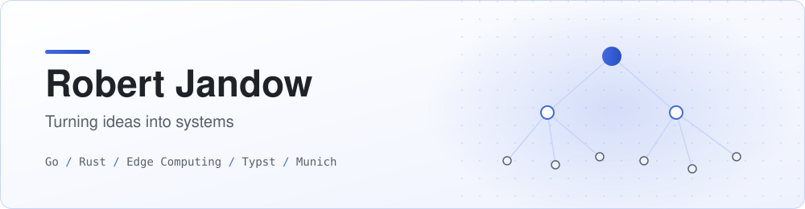

<picture>
  <source media="(prefers-color-scheme: dark)" srcset="./profile/banner-dark.svg">
  
</picture>

  PhD student at <a href="https://www.tum.de">TUM</a>, working on edge computing. 
  I mostly write <b>Go</b> and <b>Rust</b>, and build a lot of things for <a href="https://typst.app">Typst</a>.

  

### Featured

  
  
  
  
  
  

### Stats

  
  

---

### Typst

| Project | Description | Stack |
| :-- | :-- | :-- |
| [**umlaut**](https://github.com/robertjndw/umlaut) | draw.io, PlantUML and Mermaid diagrams in Typst, no Java or Graphviz needed | Rust · WASM |
| [**qrisp**](https://github.com/robertjndw/qrisp) | QR codes for Typst with custom styles, logos and colors | Rust · WASM |
| [**typstry**](https://github.com/robertjndw/typstry) | Self-hosted collaborative Typst editor, end-to-end encrypted | Rust |
| [**typst-tum-dissertation**](https://github.com/robertjndw/typst-tum-dissertation) | Dissertation template for TUM | Typst |
| [**typst-tum-presentation**](https://github.com/robertjndw/typst-tum-presentation) | Presentation template for TUM, based on Touying | Typst |
| [**typst-tum-poster**](https://github.com/robertjndw/typst-tum-poster) | Poster template for TUM | Typst |

### Go Libraries

| Project | Description |
| :-- | :-- |
| [**gosys1**](https://github.com/robertjndw/gosys1) | Unofficial client for TypeSafe's SystemOne API |
| [**go-json-crdt**](https://github.com/robertjndw/go-json-crdt) | JSON CRDT and JSON CRDT Patch |
| [**go-json-patch**](https://github.com/robertjndw/go-json-patch) | RFC 6902 JSON Patch |
| [**go-tum-login-oidc**](https://github.com/robertjndw/go-tum-login-oidc) | Log in with TUM via OIDC |
| [**go-lti-tool**](https://github.com/robertjndw/go-lti-tool) | Build LTI 1.3 tools |
| [**go-opencollection**](https://github.com/robertjndw/go-opencollection) | Read and write OpenCollection files |
| [**go-opencollection-generator**](https://github.com/robertjndw/go-opencollection-generator) | Generate OpenCollection files from your HTTP routes |

### Edge Computing

| Project | Description | Stack |
| :-- | :-- | :-- |
| [**Oakestra**](https://github.com/oakestra/oakestra) | Orchestration framework for edge computing, plus its [dashboard](https://github.com/oakestra/dashboard), [networking](https://github.com/oakestra/oakestra-net) and [CLI](https://github.com/oakestra/oakestra-cli) components | Go · Python |
| [**oakestra-dev-cli**](https://github.com/robertjndw/oakestra-dev-cli) | Run and test Oakestra locally | Go |
| [**oakestra-deploy**](https://github.com/robertjndw/oakestra-deploy) | Deploy Oakestra to your own hosts | Terraform · Ansible |
| [**oakestra-sla-gen**](https://github.com/robertjndw/oakestra-sla-gen) | Write Oakestra SLAs from a plain-text description | Python |

### Tooling & Benchmarks

| Project | Description | Stack |
| :-- | :-- | :-- |
| [**ts-executor-web**](https://github.com/robertjndw/ts-executor-web) | Run TypeScript in VS Code for the web | TypeScript |
| [**go-concurrent-map-benchmark**](https://github.com/robertjndw/go-concurrent-map-benchmark) | Concurrent map benchmarks for Hades | Go |
| [**PMDK-performance-evaluation**](https://github.com/robertjndw/PMDK-performance-evaluation) | PMDK performance evaluation scripts | Shell |
| [**docker-golangci-precommit**](https://github.com/robertjndw/docker-golangci-precommit) | pre-commit and golangci-lint in one image | Docker |

### Open Source Contributions

| Project | Description |
| :-- | :-- |
| [**Hades**](https://github.com/Hades-Scheduler/hades) | Job scheduler and CI system |
| [**PROMPT**](https://github.com/prompt-edu/prompt) | Platform for running project-based courses, and its [Go SDK](https://github.com/prompt-edu/prompt-sdk) |
| [**TUM thesis template**](https://github.com/ls1intum/thesis-template-typst) | Typst thesis template used at TUM |
| [**Eclipse Theia**](https://github.com/eclipse-theia/theia) | IDE framework. I also keep a [browser-only build](https://github.com/robertjndw/theia) ([demo](https://robertjndw.github.io/theia/)) |
| [**EduIDE**](https://github.com/EduIDE/EduIDE) | Theia-based IDE for programming courses |
